# M1-03 · Mock-ups: Today, workout player, run-walk, onboarding confirm

Product Designer · 16 Nov 2026 · Round 2 with the Advisor (max 2); round 1 critique answered below. Source: [`mockups.html`](mockups.html); PNGs in [`png/`](png/) are rendered from it with `node docs/design/m1/render.js`. Screens are iPhone 17 Pro size (393 × 852 pt). Workout content is placeholder until M1-02 lands; numbers follow the Advisor's brief (week 1 = 2 sets, ~4 in reserve, conservative start weights).

**Test every screen against the guiding rule:** if it takes thinking or admin time, it has failed. Nothing in a normal day asks the owner to choose, rate or type.

## Screens

| # | Screen | File | Build item |
|---|---|---|---|
| 1 | Today, training day | `png/today-training.png` | M1-05 |
| 2 | Today, basketball day + missing-alarm warning | `png/today-basketball-warning.png` | M1-05, M0-05 |
| 3 | Player, a set | `png/player-set.png` | M1-06 |
| 3a | Player, warm-up (step 0) | `png/player-warmup.png` | M1-06 |
| 3b | Player, one side at a time | `png/player-unilateral.png` | M1-06 |
| 3c | Player, timed hold | `png/player-hold.png` | M1-06 |
| 3d | Player, negatives | `png/player-negative.png` | M1-06 |
| 4 | Player, rest | `png/player-rest.png` | M1-06 |
| 5 | Player, session done | `png/player-done.png` | M1-06, M1-08 |
| 6 | Run-walk | `png/runwalk.png` | M1-07 |
| 7 | Onboarding confirm | `png/onboarding-confirm.png` | M1-04 |
| 8 | Onboarding permissions | `png/onboarding-permissions.png` | M1-04 |
| 9–10 | Today and player in light mode | `png/*-light.png` | — |
| 11 | Run-walk Live Activity on the lock screen | `png/runwalk-lock.png` | M1-07 |

| Today | Set | Rest | Done |
|---|---|---|---|
| 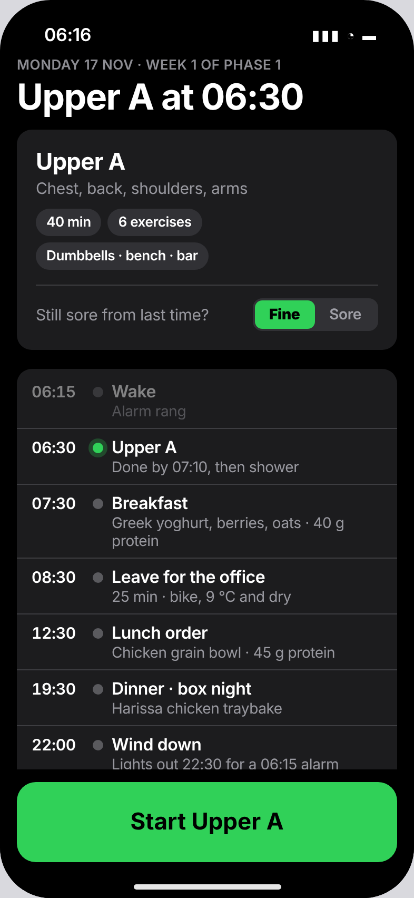 | 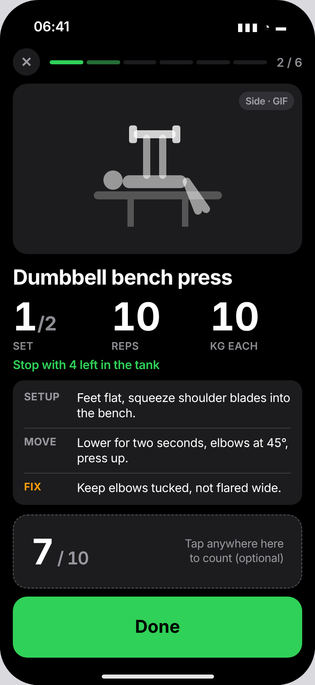 | 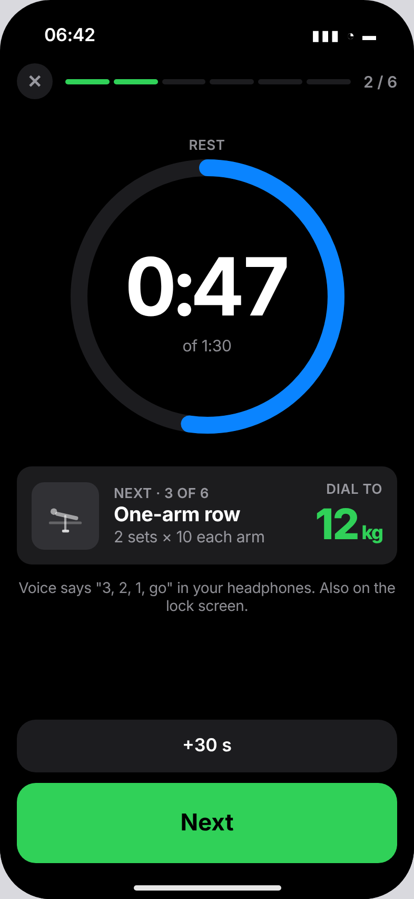 | 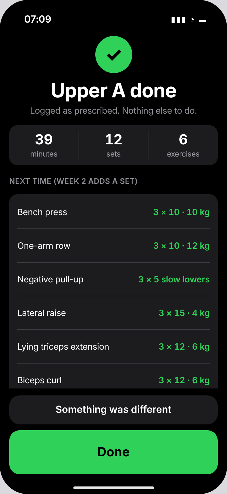 |
| **Warm-up** | **One side** | **Hold** | **Negatives** |
| 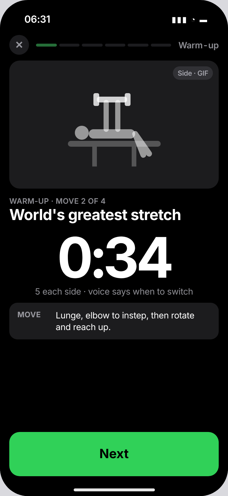 | 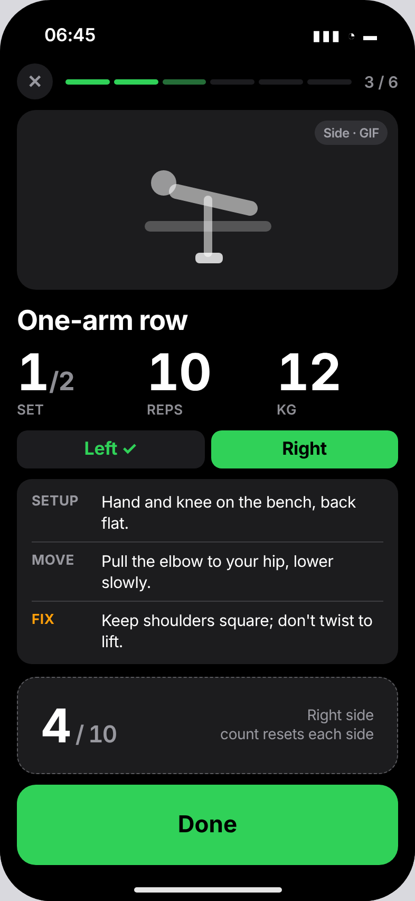 | 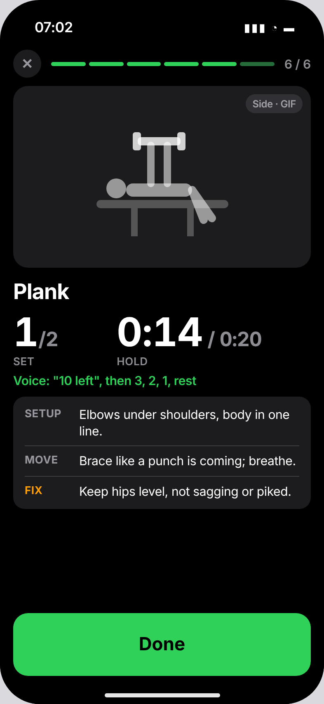 | 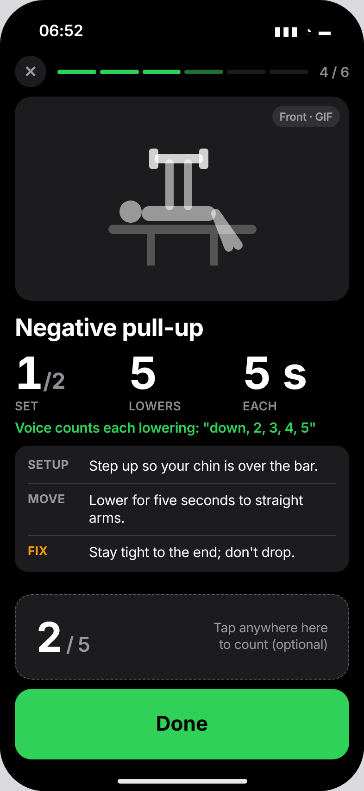 |
| **Run-walk** | **Lock screen** | **Onboarding confirm** | **Permissions** |
| 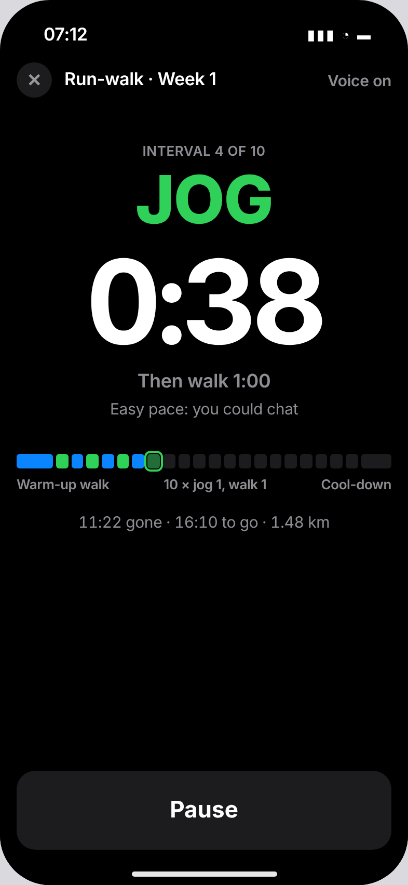 | 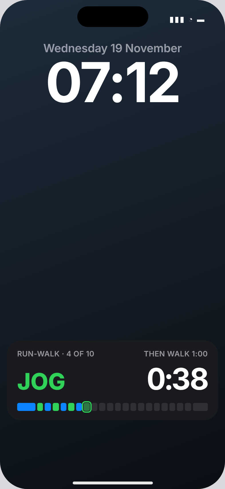 | 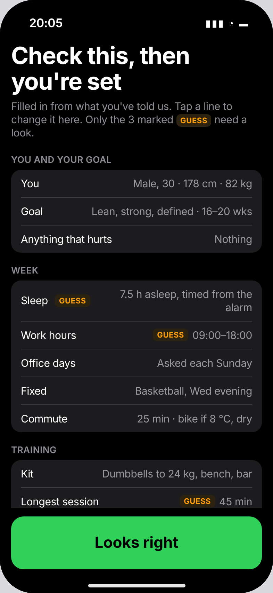 | 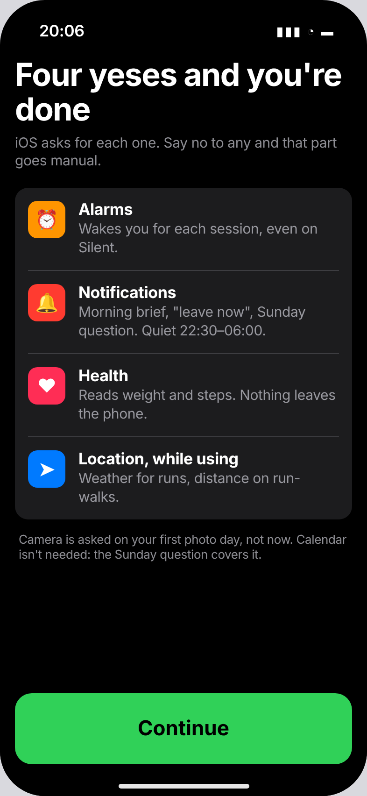 |

## Layout rules (all four screens)

- **One primary action per screen**, full width, 76 pt tall, pinned to the bottom (thumb zone), green. At most one secondary, 50 pt, grey, directly above it.
- **No small controls in the thumb zone.** The only small control is End (✕), top-left, deliberately out of reach; it asks before quitting.
- **No scrolling mid-set.** The set screen fits on one screen at 393 × 852; on smaller phones the callouts shrink first, never the numbers or buttons.
- **Readable at 1.5 m:** set, reps and weight at 48 pt bold; rest countdown 76 pt; run-walk countdown 112 pt.
- **Dark by default** (`.preferredColorScheme(.dark)` app-wide), with a Settings switch to follow the system. Light variants are shown only to prove the semantic colours work.

## Behaviour the engineers need

**Today (M1-05).** The title says what's next and when ("Upper A at 06:30"). The button starts it. On a training day the session card carries one optional row, "Still sore from last time?", with **Fine** pre-selected; ignoring it means fine. A "Sore" answer is the M1 recovery signal for the drop-to-2 rule (M1-08). Nothing else on Today asks anything. On a day with no session the button is "See tomorrow" (grey). The timeline marks past items faded and the current one with a green dot. Wake, wind-down and lights-out all come from **one sleep rule: lights out = alarm − 7.5 h − 15 min to fall asleep, wind-down 30 min before** (06:15 alarm → wind-down 22:00, lights out 22:30). Onboarding shows the rule, not a fixed bedtime. In M1 it shows wake, session and bed; breakfast, leave, lunch and dinner join in M2 and M3. If the reconcile re-set alarms, an orange banner says how many and that nothing needs doing; it clears on the next open. On basketball day, steps are one passive line (no notification, no ring) and "pack the shaker" sits on the leave row. No streaks, badges or missed-session copy anywhere.

**Workout player (M1-06).**
- Step 0 is the 5-minute warm-up: one move per card, voice-led, auto-advancing; "Next" skips ahead. It counts in the session length.
- Set types come from the programme data: **reps × kg** (screen 3), **one side at a time** (3b: "Done" on the left switches to the right with no rest and the voice says "switch sides"; "Done" on the right starts the rest; the counter resets per side), **timed hold** (3c: no reps or kg; the voice says "get in position… hold", the countdown starts by itself and the rest starts at zero) and **negatives** (3d: no kg; the voice paces each lowering).
- Set screen: "Done" logs the set **as prescribed** and starts the rest. The tap counter is optional: the whole tile is the target, and if it was used, its count is logged instead. The reps-in-reserve line ("Stop with 4 left in the tank") comes from the programme data.
- Callouts are always visible: Setup, Move, Fix (the mistake phrased as the fix, ≤ 12 words each, from M1-02).
- Rest screen: the ring counts down and the screen moves on by itself at zero. The next card shows the next exercise and **the weight to dial**, large, so the dial is set during the rest. "Next" skips the rest; "+30 s" extends it. The rest also runs as the M0-06 Live Activity with the voice countdown.
- Done screen: nothing to log, because every set was logged as it happened. It shows time, sets and the next session's loads (M1-08). "Something was different" opens one edit screen listing the sets with steppers, pre-filled; it is never a required step.
- **Rule for M1-08 (Planner Engineer):** a set logged from the counter below target counts as **held** (same load next time), never as failed, unless two sets in a row of the same exercise in one session fall short. A half-used counter (dropped phone, counting by voice) must never hold back progression on its own.
- A full session is: Start → warm-up (auto) → (Done → rest auto-advances) × n → Done. That is the M1-06 UI test path ("next" and "done" only).

**Run-walk (M1-07).** The screen shows only the current interval (JOG green, WALK blue), time left, what's next, and a segment bar. Voice calls every change ("Walk for 1 minute") through headphones, so the phone can stay locked; the Live Activity mirrors the screen. The segment bar runs warm-up walk → intervals → 2–3 min cool-down walk. The first voice cue sets the effort once: "Easy pace: you could chat"; the screen repeats it under the interval. Distance and time come from the phone and sit in one small line. One button: Pause.

**Onboarding confirm (M1-04).** One scroll of pre-filled rows from decision E6, then "Looks right". Tapping a row edits it inline (picker expands in place; no new screen). "Anything that hurts" defaults to **Nothing**; an answer there swaps exercises for their named substitutes. Only the answers the requirements draft left "to confirm" are marked **Guess** (sleep, work hours, longest session), so the owner knows which three lines deserve a glance. Then one permissions screen: Alarms, Notifications, Health, Location while using, each with one line on why; "Continue" walks through the four iOS prompts. Camera is asked on the first photo day; Calendar is never asked (Sunday prompt, D5).

## Tokens (map to SwiftUI semantic colours)

| Use | Token | SwiftUI |
|---|---|---|
| Background / cards | grouped background, secondary grouped | `Color(.systemGroupedBackground)`, `Color(.secondarySystemGroupedBackground)` |
| Primary action, jog, progress, "up" loads | green | `Color.green` (set as the app `AccentColor`) |
| Rest, walk | blue | `Color.blue` |
| Warnings, "Guess", Fix callout label | orange | `Color.orange` |
| Secondary text, separators, fills | label hierarchy | `.secondary`, `Color(.separator)`, `Color(.tertiarySystemFill)` |
| Type | SF Pro (Inter in the mock-ups) | `.largeTitle.bold()`, `.title2.bold()`; numbers use `.monospacedDigit()` |

Dynamic Type: numbers and buttons scale; callouts may truncate to two lines at the largest sizes.

## Advisor brief (section B) · answered

| # | Advisor point | Answer | Where |
|---|---|---|---|
| B1 | Today answers "what do I do now?"; next action biggest, timeline secondary | **Accepted.** Title is the next action and time; the 76 pt Start button is the biggest target; timeline sits below | Screens 1, 2 |
| B2 | Player readable from 1.5 m; GIF big enough to check form | **Accepted.** Set, reps, weight at 48 pt; GIF 220 pt tall, full width | Screen 3 |
| B3 | Sweaty, one-handed: full-width bottom next/done, no small controls, no typing, no scrolling mid-set | **Accepted.** The counter tile is one 92 pt target; End is top-left by design | Screens 3–6 |
| B4 | Rest timer dominates, with next exercise and its weight | **Accepted.** Weight shown as "Dial to 12 kg" in large green | Screen 4 |
| B5 | Callouts visible without a tap, short | **Accepted.** Always shown; labelled Setup / Move / Fix, matching A15's "phrase the mistake as the fix" | Screen 3 |
| B6 | "Done as prescribed" default; "it differed" secondary, one screen | **Accepted, changed in placement.** Logging happens per set, so the done screen needs no tap to log; the edit is one secondary button | Screen 5 |
| B7 | Dark by default; no white flash on wake | **Accepted.** App forces dark; Settings can follow the system | All; light variants 9–10 |
| B8 | Run-walk works locked; screen shows only interval, time left, what's next | **Accepted.** Stats cut to one small line; Live Activity added | Screens 6, 11 |
| B9 | Onboarding: one scroll of defaults, one "Looks right", inline editing | **Accepted, one addition:** the three unconfirmed defaults are marked Guess so the owner reads three lines, not thirty | Screen 7 |
| B10 | No streaks, badges or guilt copy; progress shows phase | **Accepted.** Header shows "Week 1 of Phase 1"; the alarm warning says it's fixed | All |
| C | Nothing asks to choose, rate or type during a normal session | **Accepted.** The only optional input is the tap counter, default unused, kept because the owner asked for tap and voice counting | Screen 3 |

## Open taste decisions (held for Gate 2, not asked)

1. **Accent colour.** Green for go, blue for rest/walk. Alternative: one brand colour. Default: green.
2. **Dark always vs follow the system.** Default: always dark, switchable in Settings.
3. **App icon.** Not designed in M1; the current placeholder stays.

Settled in round 1, no longer open: callout labels are **Setup / Move / Fix** (Advisor agreed; they read better than the plan's wording and match its "phrase the mistake as the fix"). The tap counter stays **always visible**, because the owner asked for tap and voice counting.

## Not in M1

The Sunday prompt, "tomorrow changed", weather swap copy and meal rows on Today (M2, M3); progress and photo screens (M4).

## Advisor critique round 1 · answered

Critique: `/mnt/project-files/advisor/m1-03-critique-round1.md`.

| # | Advisor point | Answer | Where |
|---|---|---|---|
| 1 | Warm-up as player step 0; run-walk cool-down | **Accepted.** Voice-led, auto-advancing warm-up card; 2–3 min cool-down walk at the end of the segment bar | 3a, 6, 11 |
| 2 | Timed-hold and negative set variants, one mock-up each | **Accepted.** Hold: countdown, no reps or kg, starts by itself. Negatives: lowers × seconds, voice-paced, no kg | 3c, 3d |
| 3 | Left/right for one-sided sets, no rest between sides, counter resets per side | **Accepted** | 3b |
| 4 | A short counted set logs as held, not failed (note for M1-08) | **Accepted.** Rule written under Workout player for the Planner Engineer | README |
| 5 | One sleep rule so onboarding and Today agree | **Accepted.** Lights out = alarm − 7.5 h − 15 min; onboarding shows "7.5 h asleep, timed from the alarm" | 1, 2, 7 |
| 6 | Optional pre-selected "still sore?" row on Today | **Accepted.** "Still sore from last time?" with Fine pre-selected, training days only | 1, 9 |
| 7 | Onboarding "Anything that hurts: Nothing" | **Accepted** | 7 |
| 8 | First voice cue "easy pace, you could chat" | **Accepted,** and repeated as one line under the interval | 6 |
| 9 | Steps passive only; shaker on the leave row too | **Accepted** | 2 |
| 10 | Show all 6 lifts on the done screen | **Accepted.** All six fit without scrolling | 5 |
| Taste | Adopt Setup / Move / Fix now; keep counter always visible | **Accepted.** Both moved out of the open list | Taste decisions |
