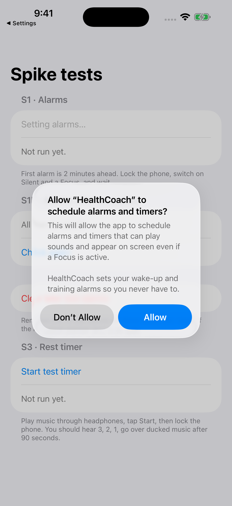
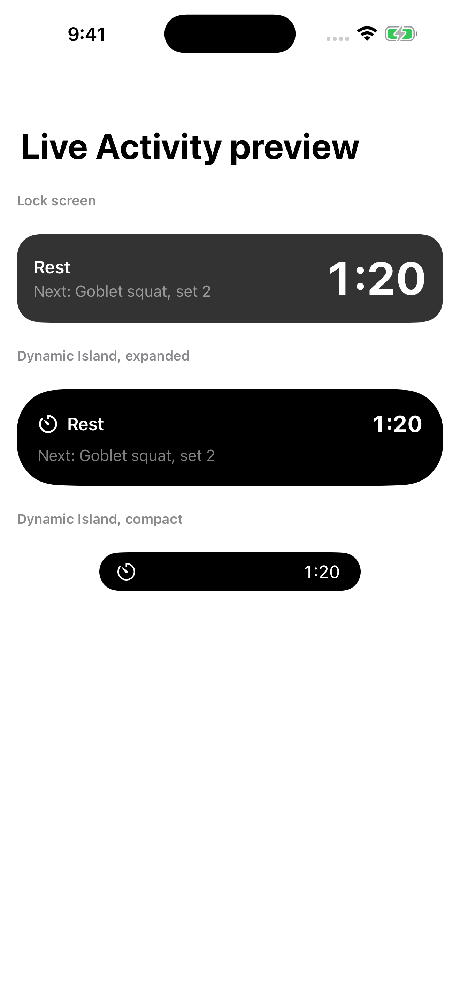
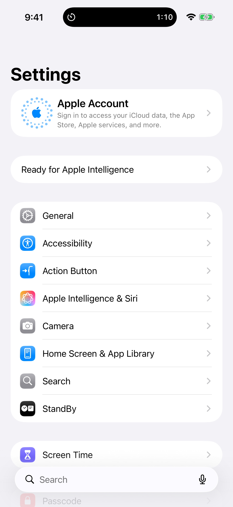
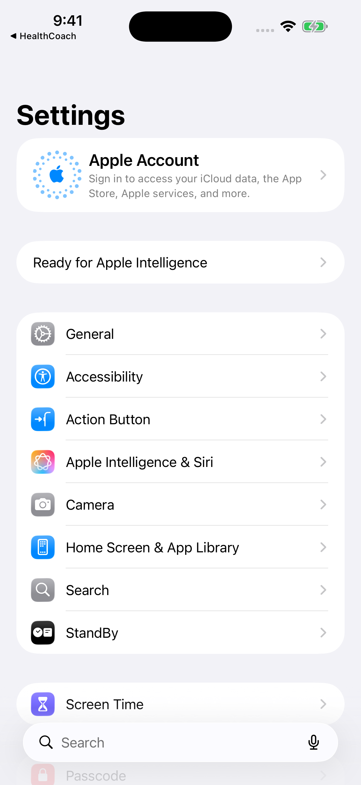

# Gate 0a pack (internal)

*Head of Engineering · 2026-11-16 · round SHA `be49d2f` · QA report: [`docs/qa/rounds/2026-11-16-gate-0a.md`](../qa/rounds/2026-11-16-gate-0a.md)*

**Recommendation: pass Gate 0a and start M1 code.** Everything the simulator can prove has passed, with no blockers or majors. The parts only a real phone can prove are built and listed below. They wait for payment, which the CEO will decide on ("I'll say when").

## What was proved, and how

| Spike | Proved in simulator / CI | Evidence |
|---|---|---|
| S0 · Pipeline | The app and Live Activity compile for iOS 26, and CoachCore tests run on every PR. A failing test turns the run red | CI runs in `m0-12-ci.md` |
| S1 · Alarms | AlarmKit exists in the iOS 26 simulator and asks permission with our wording. The 14-alarm schedule logic is unit-tested |  |
| S1b · Reconcile | Reconcile logic is unit-tested: none, some or all missing; past alarms; an empty plan never cancels | Core tests |
| S3 · Live Activity | The 90 s rest timer starts, shows in the Dynamic Island and counts down with the app in the background (1:10 → 0:38). It clears after finishing and after Cancel. The lock-screen layout renders |     |
| S2 · Calendar | Closed by decision D5: the Sunday prompt by default, never forward invites | `decisions.md` |
| S4 · GIFs | 44 exercises, each with a GIF or a named substitute, all callouts written | `s4-gifs.md`, PR #19 |

All 11 shots are in [`gate-0a/`](gate-0a/).

## Not yet proved

| Gap | When | Why it's acceptable now |
|---|---|---|
| Registering 14 alarms in the simulator, the relaunch reconcile and ID persistence (QA-2) | XCUITest that taps Allow, run in the Gate 1 round | The logic is unit-tested; only the AlarmKit wiring is unexercised |
| Alarm rings locked, on Silent and in a Focus | After payment (~15 min of on-phone tests) | M1 doesn't use alarms. **M2's wake alarms ship unproven until then**: the main risk to the plan |
| Alarms survive a TestFlight update | After payment | Reconcile on every open re-sets them if they don't |
| Lock-screen countdown while locked; voice through headphones with music ducking | After payment | Layout and countdown are proven; only lock and audio-route behaviour is open |
| Pipeline to the phone (Xcode Cloud, TestFlight) | After payment | GitHub Actions covers build and test meanwhile |

## Follow-ups (none block the gate)

- QA-1 → M2-02: zero upcoming alarms must show a warning on Today, never "all set".
- QA-2 → Planner: an XCUITest for the alarm permission and the 14-alarm path.
- QA-3 → measured CI minutes recorded: 12–16 screenshot runs a month.
- QA-4 → CI simulator set to en_GB and a 24-hour clock.

## Sign-off

| Role | Verdict |
|---|---|
| Head of QA | Pass (round 1, 2026-11-16) |
| Fitness and Nutrition Advisor | see QA report |
| Head of Engineering | Pass; recommend starting M1 code |
